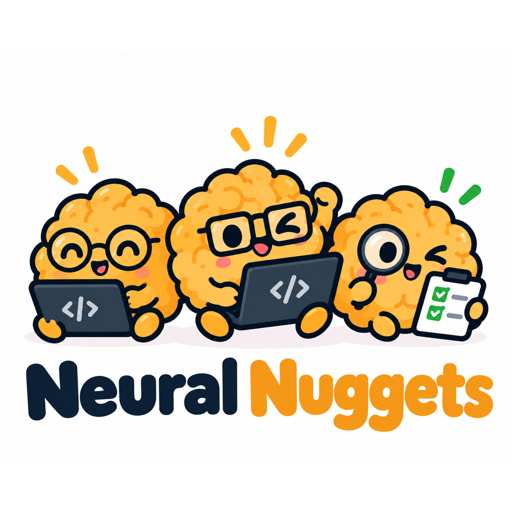
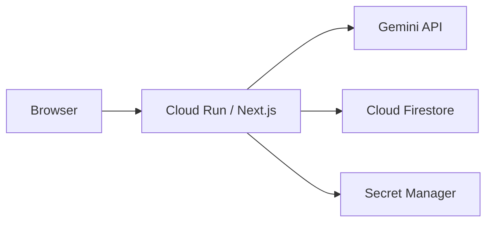

<p align="center">
  
</p>

# Teach Milo

**AI Builder Cup 2026** · Team **Neural Nuggets** · Team lead Kyaw Kyaw Oo

Teach Milo is a web app where a learner teaches a curious AI student from their own notes. Milo asks about gaps, holds a misconception to correct, and can offer a fresh task. The report quotes the learner’s own explanation.

**Problem statement:** Media, Content & Digital Experiences — personalized learning by teaching an AI student.

**Who it is for:** students and self-learners who want to practise explaining and applying a concept.

| Resource        | Link                                                                                                     |
| --------------- | -------------------------------------------------------------------------------------------------------- |
| Live app        | [teach-milo-86758133633.asia-southeast1.run.app](https://teach-milo-86758133633.asia-southeast1.run.app) |
| YouTube (3 min) | [https://youtu.be/ZchsNx0_S80](https://youtu.be/ZchsNx0_S80)                                             |
| Repository      | [github.com/kyawoo-23/teach-milo](https://github.com/kyawoo-23/teach-milo)                               |
| Submission deck | [Teach Milo - AI Builder Cup 2026.pdf](public/Teach%20Milo%20-%20AI%20Builder%20Cup%202026.pdf)          |

Guests can start without an account. The working app calls Gemini. A missing key, exhausted quota, or model failure returns an error. It does not substitute a simulated answer.

## Quick overview

| Question                               | Answer                                                                                                                                                                                       |
| -------------------------------------- | -------------------------------------------------------------------------------------------------------------------------------------------------------------------------------------------- |
| What problem does it address?          | Recognizing an explanation does not show whether a learner can explain the mechanism or apply it independently. Teach Milo makes that understanding visible through the learner’s own words. |
| What does the learner do?              | Bring notes, review the extraction, choose a focus, teach Milo, correct a misconception, and optionally attempt a new application task.                                                      |
| What makes the experience distinctive? | The learner is the teacher. Milo plays the student; a server-side evidence ledger controls readiness, and the report links feedback to stored learner quotes.                                |
| Where is AI used?                      | Gemini handles uncertain PDF extraction, lesson and board generation, student dialogue, and report generation. The server validates structured output and checks calculations.               |
| What works today?                      | An implemented web prototype with guest access, document upload, interactive teaching tools, an independent check, and a cited report.                                                       |
| What has been measured?                | Nine isolated Gemini component calls passed the benchmark’s fixture checks. Learning gains, full-session latency, and production capacity have not been established.                         |

**Reading paths:** [Try the demo](#try-the-demo) · [Inspect the assessment](#how-assessment-works) · [Verify implementation claims](#implementation-evidence) · [Review architecture](#architecture) · [Review measurements](#observed-model-timing) · [Check limitations](#boundaries) · [Run locally](#run-locally)

## Try the demo

Use the [live app](https://teach-milo-86758133633.asia-southeast1.run.app). No account or local setup is required. For a short overview first, watch the [3-minute video](https://youtu.be/ZchsNx0_S80) or open the [submission deck](public/Teach%20Milo%20-%20AI%20Builder%20Cup%202026.pdf).

The sample below is a repeatable starting point; you can also prepare lessons from your own supported documents.

1. On the home screen, choose **Upload a document**.
2. Upload [`public/samples/convolution-teaching-notes.docx`](public/samples/convolution-teaching-notes.docx). The running app also serves it at `/samples/convolution-teaching-notes.docx`.
3. Review the extracted text before teaching, including the worked case that starts at an 8×8 image.
4. Prepare a lesson. A useful focus is: “Why a larger image needs more computation but not more learned weights.”
5. Explain the idea to Milo and correct the misconception. Attach a board or sketch if it helps the explanation.
6. When the evidence supports it, the session offers an independent check. The check is optional. Ending the session still produces feedback.
7. Read the report and confirm the feedback cites what you wrote.

### What to verify during the demo

| Stage              | Expected behavior                                                                                                                                                         | What it lets you evaluate                                              |
| ------------------ | ------------------------------------------------------------------------------------------------------------------------------------------------------------------------- | ---------------------------------------------------------------------- |
| Material review    | Extracted text is editable before preparation. Inputs are PDF, DOCX, PPTX, TXT, or pasted notes; one upload up to 10 MB, PDFs up to 50 pages.                             | Whether the lesson starts from the learner’s actual material.          |
| Lesson preparation | The learner chooses focus, depth, and Milo’s language. Prep generates the lesson and board together.                                                                      | Whether the lesson fits the chosen learning goal.                      |
| Teaching           | Milo asks follow-up questions and presents a misconception to correct. The learner can attach a board, concept map, matching pairs, table, or sketch with an explanation. | Whether the dialogue elicits reasoning and examples.                   |
| Readiness          | The independent check is offered when the evidence requirements are met. There is no fixed number of teaching turns.                                                      | Whether progress reflects demonstrated understanding.                  |
| Independent check  | A fresh application task appears with practice aids hidden. It can be skipped.                                                                                            | Whether the learner can apply the idea without those aids.             |
| Report             | Feedback cites learner messages; missing evidence leaves dimensions unscored.                                                                                             | Whether each judgment can be traced to what the learner actually said. |

**Visual preview:** [Teaching screen](artifacts/classroom-desktop.png) · [Report](artifacts/report-desktop.png) · [Mobile layout](artifacts/classroom-mobile.png). These screenshots and the [backup walkthrough](artifacts/teach-milo-scripted-walkthrough.webm) use controlled browser-test responses, as explained in the [artifact notes](artifacts/README.md). Evaluate live model behavior in the app.

Lessons and boards come from the uploaded material. There is no preset topic catalog, no per-subject code path, and no teaching-turn cap.

## How a session moves

`preparing → baseline → teaching → ready_for_check → transfer → report`

`preparing` is a durable operation before a session exists. `ready_for_check` is the “Milo understood” step. `transfer` is the independent check.

An offer to take the check requires supported objectives, mechanism and demonstration evidence, correction of any introduced misconception, and no unresolved source or conceptual error. The learner can keep teaching or end the session. A hint is available once.

## How assessment works

The report covers **accuracy, mechanism, evidence, misconception correction, and independent application**. Each dimension can receive a score of 0–2 or remain unscored when evidence is insufficient or uncertain. These are session feedback scores, not a validated measure of learning gains.

- **Readiness:** the server requires cited support for every lesson objective, mechanism and demonstration evidence, correction of any introduced misconception, and no unresolved error.
- **Evidence:** report citations are checked against stored learner messages. Teaching dimensions use teaching messages; independent application uses the check response. A skipped check stays unscored.
- **Arithmetic:** generated board calculations are re-run on the server. Numeric check answers are compared with a verified calculation and tolerance; an incorrect numeric answer caps that dimension’s score at 1. Gemini assesses the reasoning.
- **Uncertainty:** source concerns can leave accuracy and application unscored. A fluent conversation alone does not establish mastery.

## Implementation evidence

These links point to the mechanisms behind the demo. Test files show the intended coverage; they are not a claim that every suite has passed in the current deployment.

| Claim to inspect                                        | Implementation                                                                                   | Relevant tests or evidence                                                                                                                                   |
| ------------------------------------------------------- | ------------------------------------------------------------------------------------------------ | ------------------------------------------------------------------------------------------------------------------------------------------------------------ |
| Reviewable document extraction                          | [Material pipeline](src/server/materials.ts), [OCR design](docs/ocr-extraction.md)               | [Extraction tests](tests/extraction.test.ts)                                                                                                                 |
| Evidence controls readiness                             | [Session controller](src/lib/controller.ts), [session orchestration](src/server/sessions.ts)     | [Domain tests](tests/domain.test.ts)                                                                                                                         |
| Reports require learner citations                       | [Assessment validation](src/lib/assessment.ts), [report contracts](src/lib/contracts.ts)         | [Report assessment tests](tests/report-assessment.test.ts)                                                                                                   |
| Boards use a shared component catalog                   | [Catalog and compiler](src/lib/board-catalog.ts), [server calculator](src/server/calculation.ts) | [Catalog tests](tests/board-catalog.test.ts), [board tests](tests/boards.test.ts)                                                                            |
| Numeric checks use verified reference values            | [Transfer reference validation](src/server/transfer-reference.ts)                                | [Transfer reference tests](tests/transfer-reference.test.ts)                                                                                                 |
| Guest work stays private and can transfer to an account | [Guest ownership](src/server/guests.ts), [authentication](src/server/auth.ts)                    | [Guest integration tests](tests/guests.test.ts), [browser coverage](tests/browser/guests.spec.ts)                                                            |
| Model timing has recorded evidence                      | [Benchmark script](scripts/benchmark-gemini.ts)                                                  | [Method and limitations](artifacts/benchmarks/2026-10-18T04-41-57-323Z/README.md), [raw summary](artifacts/benchmarks/2026-10-18T04-41-57-323Z/summary.json) |

## What is included

| Learning                                     | Platform                                                    |
| -------------------------------------------- | ----------------------------------------------------------- |
| Upload or paste, then correct the extraction | Structured replies checked with Zod                         |
| Focus, depth, and teaching language          | Board and transfer arithmetic re-run on the server          |
| Explain, and correct Milo’s misconception    | API keys in Secret Manager; passwords stored as hashes      |
| Boards, maps, matching, tables, and sketches | Guest or account; learning data expires in 7 days           |
| Independent check and cited feedback         | 5 interface languages, 9 teaching languages, light and dark |

## Architecture



The browser is the learner interface. Cloud Run hosts the Next.js app. The server validates model replies, decides readiness, and re-runs board and transfer calculations. Gemini prepares lessons, replies in chat, and writes feedback. Firestore stores material, lessons, conversations, and evidence. Secret Manager holds server-side credentials. Cloud Build and Artifact Registry deploy the container to Cloud Run in Singapore.

| Technology                        | Role                                                        |
| --------------------------------- | ----------------------------------------------------------- |
| Gemini and the Google Gen AI SDK  | Extraction, lessons, activities, chat, and feedback         |
| Next.js, React, and TypeScript    | Site and API routes                                         |
| Cloud Run                         | Container hosting in Singapore                              |
| Cloud Firestore                   | Material, lessons, conversations, and evidence, with expiry |
| Cloud Build and Artifact Registry | Image build and deploy                                      |
| Secret Manager                    | API keys and auth secrets                                   |
| Zod and a calculation sandbox     | Structured replies and numeric checks                       |

### Where the code lives

- `src/app` — routes and API handlers
- `src/components` — preparation, chat, boards, the check, and the report
- `src/lib` — Zod contracts, the 17-component board catalog and compiler, grading, and board validation
- `src/server` — ownership, Firestore, operations, extraction, lesson preparation, Gemini, and session orchestration (`server-only`)
- `src/content` — private prompts
- `scripts/extract-worker.mjs` — document parsing with memory and time limits

## Languages

The site UI is English, Simplified Chinese, Japanese, Korean, and Thai. The selector stores the choice in this browser for one year. With no saved choice, the browser language picks the first visit. URLs stay the same.

Choose Milo’s language before preparing a lesson. It starts from the site language and stays with the lesson across sign-in. Lesson text, Milo’s messages, the independent check, and feedback stay in that language when the site language changes. Teaching languages also include Vietnamese, Indonesian, Malay, and Burmese. Existing lessons default to English. Source text and learner quotes are left as written. Prepare a new lesson to change Milo’s language.

Translations live in `src/lib/i18n`. Add the same keys and interpolation parameters to every UI dictionary. English is the key set.

## Observed model timing

The [benchmark evidence and methodology](artifacts/benchmarks/2026-10-18T04-41-57-323Z/README.md) record measurements with direct Gemini SDK calls to `gemini-3.5-flash-lite` on 18 Oct 2026 (`n=9`, one call at a time). This excludes app and HTTP time, PDF OCR, and concurrent load. Structured JSON and fixture checks were 9/9. It is not a claim about general accuracy or capacity.

| Workload           | API OK | p50 / max       | Input / output tokens |
| ------------------ | ------ | --------------- | --------------------- |
| Lesson preparation | 3/3    | 5.20 s / 5.80 s | 5,793 / 5,008         |
| Teaching reply     | 3/3    | 2.50 s / 2.70 s | 3,513 / 1,624         |
| Report evaluation  | 3/3    | 4.07 s / 4.21 s | 3,849 / 3,918         |

Paced throughput in that run was 2.76 successful calls per minute with 20-second gaps. The paid-equivalent API cost for those nine calls was about US$0.03. An illustrative 1,000-session estimate in the [submission deck](public/Teach%20Milo%20-%20AI%20Builder%20Cup%202026.pdf) is about US$0.019 of Gemini usage per session at the stated token assumptions. Hosting and Firestore are separate. Free-tier charge is US$0 only when the account is eligible.

## Boundaries

Custom material is checked against the source and the model’s knowledge, not against an external fact base. Ambiguous material can leave a criterion unscored. A generated board can be numerically bounded and still be a weak scientific model. Source assumptions and the learner’s interpretation still matter.

Inputs are PDF, DOCX, PPTX, TXT, and pasted notes. Voice, web search, standalone images, and recordings are out of scope. PPTX yields slide text only (up to 50 slides). Images, charts, diagrams, native equations, and speaker notes in a PPTX are skipped; use a PDF when the visual layout matters.

## Run locally

Requirements: Node **24.15+**, pnpm **11.21**, JDK **21+**, and a Gemini API key for a model that supports structured JSON and PDF vision. Firebase CLI is a project dependency. Local development uses the Firestore emulator.

```sh
corepack enable
corepack prepare pnpm@11.21.0 --activate
pnpm install --frozen-lockfile
cp .env.example .env.local
```

Set `GEMINI_API_KEY` in `.env.local` and keep it server-side. The example environment selects `GEMINI_MODEL=gemini-3.5-flash-lite`; if that variable is unset, the code falls back to `gemini-3.8-flash`. Use a model available to your account that supports the required structured output and PDF vision.

Start the emulator and the app in two terminals:

```sh
pnpm emulators
```

```sh
pnpm dev
```

Open **http://127.0.0.1:3000**. Sign-in cookies and origin checks are tied to that host. The emulator UI is **http://127.0.0.1:4000**. `pnpm doctor` checks prerequisites and does not print credentials. The emulator writes `.emulator-data` on a clean shutdown. `pnpm cleanup` removes expired local records.

### Checks

```sh
pnpm typecheck
pnpm test                     # unit and extraction; emulator suites skip until an emulator is configured
pnpm test:integration         # starts its own emulator; stop any emulator already running
pnpm exec playwright install chromium
pnpm test:e2e                 # browser fixtures, desktop and mobile; starts the app if needed
pnpm test:http                # local API smoke; needs the app and emulator
pnpm record:walkthrough       # paced, labeled scripted recording
pnpm build
```

Against an emulator that is already running:

```sh
GOOGLE_CLOUD_PROJECT=demo-teach-milo FIRESTORE_EMULATOR_HOST=127.0.0.1:8080 pnpm test
```

Browser tests intercept API responses. Integration tests use the Firestore emulator and a controlled model. Neither spends on Gemini. After a real key is added, smoke-test with mixed or scanned material, a custom lesson, and a report that cites the learner.

`artifacts/` holds screenshots and a labeled scripted walkthrough from the browser tests. That recording is a demonstration backup, not live inference.

Guest browser coverage, with the emulator and the app at `http://127.0.0.1:3000`:

```sh
FIRESTORE_EMULATOR_HOST=127.0.0.1:8080 pnpm exec playwright test tests/browser/guests.spec.ts
```

Those tests script lesson generation and call the real guest, account, material, and session APIs.

## Materials and boards

PDF.js inspects each page. Clean prose uses native text. Confirmed blank pages skip OCR. Uncertain pages go to Gemini in batches of up to five, with original page numbers kept. OCR uncertainty is visible in the review. Original bytes exist only during processing. They are not stored in Firestore and are not sent to the Gemini Files API. See [OCR extraction](docs/ocr-extraction.md).

Validated PDF extractions are cached by user, exact bytes, model, prompt, and extraction version. A renamed file still hits the cache. Interrupted uploads resume after successful batches. Cache lifetime starts at first extraction and is not renewed by reuse.

DOCX archives pass a streamed ZIP preflight (500 entries, 25 MB decompressed) before plain-text extraction. TXT must be valid UTF-8. Password-protected PDFs and damaged files return a clear error. Uploaded documents are source material, never system instructions.

Each lesson board is composed in the same Gemini call from 17 catalog components in `src/lib/board-catalog.ts`: layout (Stack, Row, Card), content (Heading, Text, Callout), inputs (Slider, NumberInput, Toggle, Select), displays (Metric, Bar, Grid, LineChart), and composites (SortableList, Buckets, CompareCards). A board declares up to 8 named state variables, derived values, and at most one `calculate(inputs)` function. Components bind to those ids. Boards without interactive components can seed a concept map, matching pairs, or a table. The board is frozen with the lesson.

`compileBoard` checks every node, drops unknown pieces with diagnostics, and enforces 40 nodes, 8 state variables, and 4 levels of nesting. A fatal board gets one repair call, then an editable example table. `calculate` allows arithmetic, approved `Math` functions, locals, and conditionals. Imports, loops, recursion, strings, constructors, arbitrary property access, and globals are rejected.

In the browser, React renders the controls. Only `calculate` runs, inside a worker in a sandboxed frame, and the worker is stopped after 500 ms. The server re-runs `calculate` and stores a verified snapshot. Milo and the evaluator see labelled `{label, value, unit}` entries. Board values illustrate the idea. They are not the assessment key.

When the transfer question asks for numbers, prep also writes up to four expected fields, the question inputs, and a `calculate` function. The server keeps that key only when the function reproduces every expected value. A learner entry outside tolerance caps the transfer score at 1 and is explained in the report. The model still scores the reasoning.

The tool selector always offers a sketchpad, concept map, matching pairs, and a comparison table. Attaching a board or sketch requires an explanation. Drawings add context. Readiness and assessment still use the learner’s words. Lessons stored before the catalog show the example table.

## Access, expiry, and deploy

The first material submission creates a private guest. Ordinary page visits do not. Guest work uses the same ownership checks as an account. Optional sign-in is email and password, Google, or a passkey enrolled after sign-in. Signing in moves the guest’s unexpired material onto the account and does not extend the 7-day learning-data retention. Auth cookies last 30 days. Firestore rules deny direct browser access. Mutation requests check `Origin`.

Session history returns 20 sessions per page. Seven-day expiry is enforced on every read. TTL is asynchronous, so the app also checks expiry, and production should run `node scripts/cleanup.mjs` daily.

`next.config.ts` sends a Content Security Policy on every route. Gemini, Firestore, and Google token requests stay on the server. Browser coverage is in `tests/browser/csp.spec.ts`.

**Passkeys on a laptop:** WebAuthn needs `APP_ORIGIN=http://localhost:3000` and `pnpm exec next dev --webpack --hostname localhost`. The usual `127.0.0.1` origin cannot be a WebAuthn RP ID. Match the Google redirect URI if you test Google sign-in at the same time.

Build the production image with:

```sh
docker build --platform linux/amd64 -t teach-milo .
```

The image uses Webpack. Turbopack’s CSS subprocess needs local port permissions that this build environment does not have. Deploy with Cloud Build (`cloudbuild.yaml`). Set `_APP_ORIGIN` to the service HTTPS URL. Leave `FIRESTORE_EMULATOR_HOST` unset in production. Deploy Firestore rules and indexes, including TTL, and wait until the `sessions` composite indexes are ready before paginated history will succeed. Public access on the Cloud Run service is a launch choice. Local commands do not deploy to the cloud.
